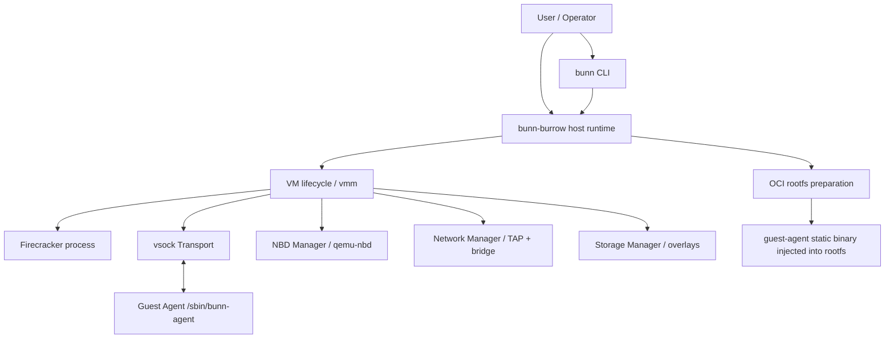
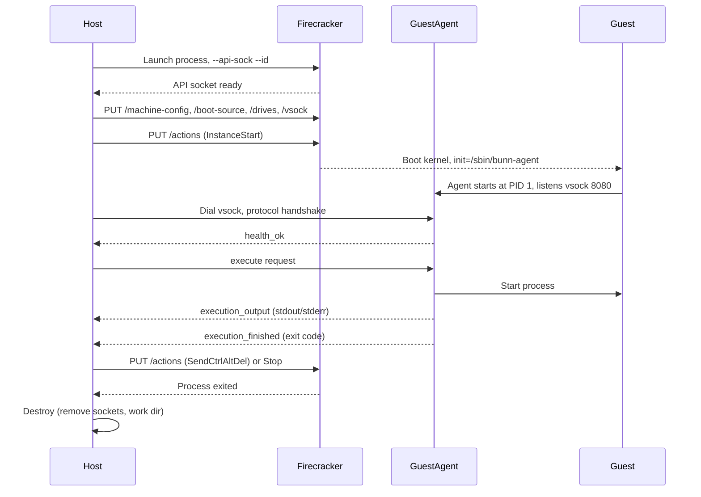
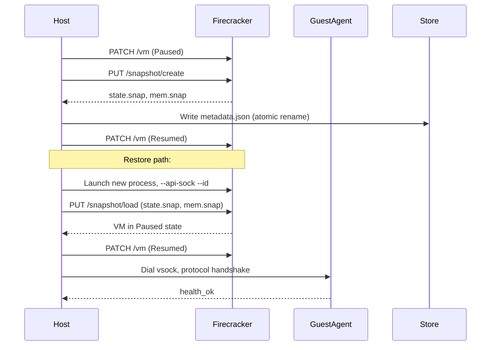

# docs/ARCHITECTURE.md — Bunn Burrow System Architecture

This document describes the system architecture of Bunn Burrow as implemented
in the source code. It is the source of truth for architectural decisions and
capability maturity. `CLAUDE.md` and `AGENTS.md` point here for details;
do not duplicate large sections between the three files.

If a code change affects architecture (new component, changed data flow, new
capability, changed limitation), update this document in the same change.

## Capability maturity

Each section and capability below is tagged with one of:

- **Implemented** — code exists, unit-tested, works end-to-end in supported
  configurations.
- **Experimental** — code exists and is exercised by unit tests, but
  end-to-end workflows are not established as supported.
- **Planned** — interface or stub exists; behavior is documented as deferred.
- **Unsupported** — explicitly not available or not safe to use.

## Overview

Bunn Burrow is a local Linux application for running commands in Firecracker
microVMs. It has three independent Go modules:

| Module | Path | Module path | Role |
|--------|------|-------------|------|
| Host runtime | `.` | `github.com/Bunn-Burrow/bunn-burrow` | VMM lifecycle, storage, networking, templates, snapshots, CLI entry points |
| Guest agent | `guest-agent/` | `github.com/Bunn-Burrow/bunn-burrow/guest-agent` | Runs inside the guest at PID 1, serves vsock requests |
| Developer CLI | `bunn-cli/` | `github.com/Bunn-Burrow/bunn-cli` | Local `bunn` CLI; uses the host module directly |

There is no persistent host daemon, no remote control plane, and no
cross-invocation VM registry. VM lifecycle is process-local:
`bunn vm run` and `bunn terminal run` own a foreground VM session. The root
`bunn-burrow start` command boots a VM, waits for Guest Agent readiness,
requests guest shutdown, and destroys the VM. The root `bunn-burrow exec`
command boots and destroys a VM around a workload.

Component relationships:



## Repository and package relationships

### Host runtime (`github.com/Bunn-Burrow/bunn-burrow`)

| Package | Responsibility | Maturity |
|---------|---------------|----------|
| `vmm` | VM lifecycle (start/pause/resume/stop/destroy), Firecracker process management, vsock transport, snapshot create/restore/fork, state machine, API client wrapper | Implemented (lifecycle), Experimental (snapshots/fork) |
| `vmm/sandbox` | Sandbox abstraction: isolated VM per workload, execute/upload/download/PTY sessions over vsock | Implemented |
| `internal/network` | TAP devices, bridge, IPAM, firewall, network allocation per VM | Experimental |
| `internal/storage` | NBD device management, storage manager, garbage collection, volume management, snapshot store adapter | Experimental/library-only |
| `internal/template` | Template registration, validation, reference counting | Experimental/library-only |
| `internal/vmimage` | Image inspection and management | Experimental/library-only |
| `internal/rootfs` | ext4 rootfs construction | Implemented (preparation tool) |
| `internal/image` | OCI image cache and layer resolution | Experimental |
| `internal/envcache` | Environment cache for prepared images | Experimental |
| `internal/prepare` | OCI rootfs preparation harness | Implemented (tool) |
| `pkg/environment` | Environment preparation profiles | Experimental |

### Guest agent (`github.com/Bunn-Burrow/bunn-burrow/guest-agent`)

| Package | Responsibility | Maturity |
|---------|---------------|----------|
| `guestagent` | Agent state machine, process management, signal handling, reaping | Implemented |
| `vsock_server` | vsock protocol server: health, shutdown, execute, cancel, upload/download, PTY sessions, snapshot coordination handlers | Implemented |
| `session` | PTY session management | Implemented |
| `process` | Guest process lifecycle | Implemented |
| `network` | Guest network configuration | Implemented |
| `workspace` | Guest workspace file operations | Implemented |
| `reaper` | Child process reaping | Implemented |
| `signals` | Signal handling | Implemented |

### Developer CLI (`github.com/Bunn-Burrow/bunn-cli`)

| Package | Responsibility | Maturity |
|---------|---------------|----------|
| `cli` | Cobra commands: config, vm, runtime, terminal, sandbox | Implemented (sandbox create), Unsupported (sandbox info/exec/logs/pause/resume/fork - require persistent daemon) |
| `config` | Configuration loader (defaults, env vars, config file, CLI flags) | Implemented |
| `output` | Output formatting (table, json, text) | Implemented |

#### CLI command reference

| Command | Subcommands | Backend method | Status | Notes |
|---------|-------------|----------------|--------|-------|
| `bunn config` | init, view, path | config.Loader | Implemented | Configuration management |
| `bunn vm` | run, stop, delete, list | vmm.New, vm.Start/Stop/Destroy | Implemented | Session-scoped VM lifecycle |
| `bunn runtime` | list, inspect | config.Loader | Implemented | Host capability inspection |
| `bunn terminal` | run | vmm.NewSandbox, sandbox.StartSession | Implemented | Interactive PTY session |
| `bunn sandbox` | create, info, exec, logs, pause, resume, fork | vmm.NewSandbox | Partially implemented | Only `create` is functional |

#### Sandbox command details

The `bunn sandbox` command group exposes the `vmm.Sandbox` abstraction through the CLI. Because Bunn Burrow has no persistent host daemon, sandbox lifecycle is process-local: VMs created by one `bunn` invocation cannot be managed by another.

| Command | Backend method | Status | Notes |
|---------|---------------|--------|-------|
| `sandbox create [vm-id]` | `vmm.NewSandbox`, `sandbox.Start`, `sandbox.Close` | Implemented | Creates a sandbox VM, starts it, waits for guest agent readiness, runs in foreground until interrupted, then destroys |
| `sandbox info <id>` | None | Unsupported | Requires a persistent host-side VM registry/daemon to look up VM by ID |
| `sandbox exec <id> -- <cmd>` | `sandbox.Execute` | Unsupported | Requires a persistent host-side VM registry/daemon to connect to an existing VM |
| `sandbox logs <id>` | None | Unsupported | Requires a persistent host-side VM registry/daemon to access VM logs |
| `sandbox pause <id>` | `vm.Pause` | Unsupported | Requires a persistent host-side VM registry/daemon to pause an existing VM |
| `sandbox resume <id>` | `vm.Resume` | Unsupported | Requires a persistent host-side VM registry/daemon to resume an existing VM |
| `sandbox fork <id>` | `vm.Fork` | Unsupported | Requires a persistent host-side VM registry/daemon to fork an existing VM |

#### Session scope

All CLI commands are session-scoped. VMs created by one `bunn` invocation cannot be stopped, inspected, or managed by another invocation. There is no persistent daemon, no remote control plane, and no cross-invocation VM registry.


## Host runtime

### VM lifecycle state machine

The host-side lifecycle is tracked by `vmm.StateMachine` (`vmm/state.go`),
distinct from Firecracker's own instance state (`Not started` / `Running` /
`Paused`), which is queried separately via the API.

Allowed transitions:

```
Created   -> Preparing   (Firecracker launched, API socket awaited)
Preparing -> Running     (devices configured, instance started)
Running   -> Paused      (pause requested)
Paused    -> Running     (resume requested)
Paused    -> Snapshotting (snapshot requested)
Snapshotting -> Paused   (snapshot complete)
Running   -> Stopping    (stop requested)
Stopping  -> Stopped     (process termination confirmed)
Stopped   -> Destroying  (destroy requested)
Destroying -> Destroyed  (resources cleaned)
any       -> Failed      (terminal error)
```

`Stop` and `Destroy` are idempotent: `Stopping`/`Stopped`/`Destroyed` are
stable under repeated calls. `StateFailed` is terminal.

Key invariants:

- Every start path (`vm.Start`) has a matching cleanup defer that rolls back
  layers, network, volumes, and images on failure.
- `vm.Stop()` escalates: Ctrl+Alt+Del → SIGTERM → SIGKILL on successive
  timeouts, waiting for confirmed termination before reporting stopped.
- `vm.Destroy()` force-terminates any still-running process, removes socket
  files and work-directory contents, and transitions to `Destroyed`.
- Unexpected Firecracker exit during `Running` transitions to `Failed` via
  `monitorExit()` (`vm.go:706`). Exits during `Stopping`/`Stopped`/
  `Destroying`/`Destroyed`/`Failed` are treated as expected shutdowns.

### VM struct and resources

`vmm.VM` (`vm.go`) owns:

- Lifecycle state (`sm *StateMachine`)
- Firecracker API client (`api API`)
- Firecracker process handle (`proc *Process`)
- Vsock transport (`transport *Transport`)
- Exit channel (`exitCh`) and exit error (`exitErr`)
- Optional: `TemplateStore`, `LayerMgr`, `NBDMgr`, `StorageManager`,
  `VolumeManager`, `ImageManager`, `TemplateManager`, `NetworkManager`
- VM-owned resources: writable layer, NBD device, attached volumes, network

Each VM gets a unique ID, private working directory, API socket path, and
vsock socket path. The exclusive `os.Mkdir` on the per-VM directory prevents
a reused ID from adopting files belonging to an earlier VM.

### Firecracker process management

Firecracker is launched as a subprocess (`vmm.Process`, `process.go`) via
`vm.startProcessAndWait()`:

```go
firecracker --api-sock <vm-dir>/api.socket --id <vm-id> [--log-path <log> --level Debug]
```

- Stdout (guest serial console) is appended to `console.log` in the VM work
  directory.
- A `monitorExit()` goroutine watches for unexpected process exits and
  transitions the VM to `Failed` when running.
- `startProcessAndWait()` waits for the API socket to accept `GetMachineConfiguration`,
  bounded by `StartTimeout`.

### Firecracker API surface

`vmm.API` (`api.go`) wraps the Firecracker Go SDK client:

| Method | Firecracker API | Timing |
|--------|---------------|--------|
| `PutMachineConfiguration` | `PUT /machine-config` | Pre-boot only |
| `PutGuestBootSource` | `PUT /boot-source` | Pre-boot only |
| `PutGuestDriveByID` | `PUT /drives/{id}` | Pre-boot only |
| `PutGuestNetworkInterfaceByID` | `PUT /network-interfaces/{id}` | Pre-boot only |
| `PutGuestVsock` | `PUT /vsock` | Pre-boot only |
| `CreateSyncAction` | `PUT /actions` | InstanceStart / SendCtrlAltDel |
| `PatchVM` | `PATCH /vm` | Pause / Resume |
| `CreateSnapshot` | `PUT /snapshot/create` | Paused state |
| `LoadSnapshot` | `PUT /snapshot/load` | Pre-boot only |
| `GetInstanceInfo` | `GET /` | Any |
| `GetMachineConfiguration` | `GET /machine-config` | Any |

Important version-specific behaviors (Firecracker v1.17.0):

- `LoadSnapshot` must be called before any device configuration. Firecracker
  rejects machine config, boot source, and drives before snapshot load.
- `PutGuestVsock` is rejected after the microVM has started ("not supported
  after starting").
- `SnapshotLoadParams` in the Go SDK does **not** expose `vsock_override`,
  even though Firecracker v1.17.0's REST API accepts it. Bunn Burrow implements
  `LoadSnapshotWithOverride` (`vmm/api.go`) using raw HTTP PUT over the API
  socket to send `vsock_override.uds_path` during snapshot restore.

## Firecracker integration

### Boot sequence (`vm.Start`, `vm.go:219`)

1. `Created → Preparing`
2. Resolve template or image (creates writable layer + NBD mapping)
3. Allocate network resources (TAP, bridge, IPAM)
4. `startProcessAndWait()` — launch Firecracker, wait for API socket, create API client
5. Attach volumes (NBD block devices)
6. `configureDevices()` — machine config, boot source, root drive, volumes, network interface
7. `configureVsock()` — `PutGuestVsock`, bind `vm.transport`
8. `CreateSyncAction(InstanceStart)` — start the guest
9. `Preparing → Running`

### Pause / resume (`vm.Pause`, `vm.Resume`, `vm.go:751/765`)

- `Pause`: `Running → Paused` via `PATCH /vm {state: "Paused"}`. Reverts to
  `Running` if the API call fails.
- `Resume`: `Paused → Running` via `PATCH /vm {state: "Resumed"}`. Reverts to
  `Paused` if the API call fails.

### Stop (`vm.Stop`, `vm.go:783`)

Escalation sequence with confirmed termination at each step:

1. `Running/Paused → Stopping`
2. Send `Ctrl+Alt+Del` (graceful guest shutdown)
3. Wait for process exit (`StopTimeout`)
4. Escalate: SIGTERM, wait (`StopGraceTimeout`)
5. Escalate: SIGKILL, wait (`StopGraceTimeout`)
6. On termination: release runtime (sockets), network, volumes, image; `Stopping → Stopped`
7. If still alive after SIGKILL: return error, VM remains in `Stopping`

### Destroy (`vm.Destroy`, `vm.go:907`)

Destroy is safe to call from any lifecycle state and is idempotent:
`Destroyed` returns `nil` immediately, and `Destroying` returns `nil`
for concurrent callers.

State-specific pre-cleanup:

| State | Action |
|-------|--------|
| `Running`/`Paused` | Best-effort graceful shutdown via `Stop` (Ctrl+Alt+Del → SIGTERM → SIGKILL), then force-terminate if needed |
| `Stopping` | Wait for the in-progress stop to complete (or context cancellation) |
| `Preparing`/`Snapshotting`/`Failed` | Force-terminate the Firecracker process immediately |
| `Created` | No process started; nothing to terminate |
| `Destroyed` | Return `nil` (idempotent) |
| `Destroying` | Return `nil` (concurrent destroyer in progress) |

After state-specific handling:
1. `TransitionTo(StateDestroying)` — marks destruction in progress so
   unexpected process exits are not reported as lifecycle failures
2. Force-kill any still-running process (5s timeout)
3. `releaseRuntime()` — remove API and vsock socket files
4. `releaseNetwork()` — release TAP/IPAM/firewall resources
5. `detachVolumes()` — detach all attached volumes
6. `removeOwnedArtifacts()` — remove VM's private working directory contents
7. `removeWritableLayer()` — release writable layer, NBD mapping, template refs
8. `unmapImage()` — unmap image NBD device
9. `shutDownNetworkMgr()` if owned
10. Clear `api`, `proc`, `transport` references
11. `TransitionTo(StateDestroyed)`

Cleanup errors are collected and returned via `errors.Join`; they are never
silently ignored. Shared kernel/rootfs images are preserved; only VM-owned
artifacts are removed.

The internal `destroy(ctx, force)` helper (used by fork failure cleanup)
follows the same cleanup pattern without the state-specific pre-cleanup.

### Integration testing

Firecracker integration tests are gated behind environment variables and are
not run by default. To run them:

```bash
BUNN_RUN_FIRECRACKER_SNAPSHOT_TEST=1 \
FIRECRACKER_BIN=/path/to/firecracker \
FIRECRACKER_KERNEL=/path/to/vmlinux \
FIRECRACKER_ROOTFS=/path/to/rootfs.ext4 \
go test -v -count=1 -timeout 300s -run "TestFork|TestIntegration|TestRestoreSnapshot" ./vmm/
```

Required assets:
- Firecracker v1.17.0 binary (`FIRECRACKER_BIN`)
- Kernel image (`FIRECRACKER_KERNEL`)
- Rootfs ext4 image containing `/sbin/bunn-agent` (`FIRECRACKER_ROOTFS`)
- `/dev/kvm` accessible

Integration tests cover: VM lifecycle (start/pause/resume/stop/destroy),
snapshot create/restore, fork with two concurrent children, independent vsock
communication, guest-agent health checks, snapshot integrity verification,
concurrent destroy, failure cleanup, and repeated destroy idempotency.

## Guest agent

### Role

The guest agent (`/sbin/bunn-agent`) runs at PID 1 inside the guest. It
validates this with `ValidatePID1()`. It serves host requests over vsock
(port 8080) and manages guest processes, PTY sessions, file transfers, and
shutdown.

### Agent state machine

```
starting -> ready -> stopping -> stopped
```

- `Run(ctx, signals, reap)` — main event loop; `ctx` is cancelled on vsock
  shutdown request; `signals` handles `SIGCHLD` (reap) and `SIGTERM`/`SIGINT`/
  `SIGQUIT` (shutdown).
- `shutdown()` — `ready → stopping → stopped`, calls `shutdownFn`.

### Vsock server

`guestagent.Server` (`vsock_server.go`) listens on AF_VSOCK port 8080 and
handles:

| Request kind | Response kind | Purpose |
|------------|---------------|---------|
| `protocol` | `protocol` | Handshake (bunn-vsock v1) |
| `health` | `health_ok` | Health check |
| `shutdown` | `shutting_down` | Request guest shutdown |
| `execute` | `execution_started` / `execution_output` / `execution_finished` / `error` | Run a guest process |
| `cancel` | `execution_cancelled` | Cancel a running execution |
| `upload_project` | `upload_started` / `upload_finished` | Transfer tar archive to workspace |
| `download_file` | file frames / `download_complete` | Retrieve a file from workspace |
| `session_start` | `session_started` | Start a PTY session |
| `session_input` | `session_input_acked` | Send input to a PTY session |
| `session_resize` | `session_resized` | Resize a PTY session |
| `session_status` | `session_status` | Query PTY session status |
| `session_terminate` | `session_terminated` | Terminate a PTY session |
| `session_detach` | `session_detached` | Detach from a PTY session |
| `prepare_snapshot` | `snapshot_prepared` | Snapshot coordination (host not wired) |
| `sync_filesystems` | `filesystems_synced` | Snapshot coordination (host not wired) |
| `freeze_filesystems` | `filesystems_frozen` | Snapshot coordination (host not wired) |
| `thaw_filesystems` | `filesystems_thawed` | Snapshot coordination (host not wired) |
| `snapshot_ready` | `snapshot_ready` | Snapshot coordination (host not wired) |

Snapshot coordination handlers exist on the guest side but are **not invoked**
by the host `SnapshotCoordinator`. Filesystem-consistent snapshots are not
implemented (`Planned`).

### Guest agent build

Built as a static binary (`CGO_ENABLED=0`) via
`cd guest-agent && GOWORK=off CGO_ENABLED=0 go build -o ../bin/guest-agent-static ./cmd/guest-agent`.

## Vsock communication and protocol

### Framing

Both host and guest use length-prefixed JSON framing:

```
4-byte big-endian length prefix + JSON payload
```

Maximum frame size: 1 MiB (`1 << 20`).

### Host-initiated connections

Firecracker listens on a Unix domain socket (`uds_path`). The host dials that
socket and sends:

```
CONNECT <guest-port>\n
```

Firecracker replies:

```
OK <assigned-host-port>\n
```

After the handshake, the connection is a regular `net.Conn` to the guest's
vsock port.

### Guest-initiated connections

Firecracker forwards guest connections to AF_UNIX sockets at
`<uds_path>_<port>`. The host must create and listen on those sockets.

### Vsock transport

`vmm.Transport` (`vsock.go`) is bound to one VM's vsock UDS socket and guest
CID. Each VM has its own `Transport`; connections cannot cross VM boundaries.

### Vsock CID

Guest CID is `>= 3` (CIDs 0–2 reserved by Firecracker). Sandbox VMs assign a
unique CID via `nextVsockCID()` starting at 3 (`sandbox.go:1741`). For
host-initiated connections, the CID is not used by the host; the host dials
each VM's own UDS socket.

## VM creation and boot

### Direct rootfs creation

When `Config.RootFS` is set directly (no `TemplateID`, no `ImageID`), Firecracker
boots from the raw rootfs path. The rootfs must be an ext4 image containing
`/sbin/bunn-agent` for Guest Agent-backed workflows.

### Template-based creation

When `Config.TemplateID` is set:

1. Look up template in `TemplateStore`, validate integrity
2. Acquire template reference
3. `LayerMgr.CreateLayer(templateID, vmID)` — create per-VM writable qcow2 layer
4. `NBDMgr.Map(layerPath, vmID)` — map layer to `/dev/nbdN` via qemu-nbd
5. Set `vm.cfg.RootFS = nbdDevice`
6. Register with `StorageManager` (if configured)

Firecracker does not understand qcow2 natively; the NBD device exposes the
overlay as a raw block device.

### Image-based creation

When `Config.ImageID` is set:

1. `ImageManager.InspectImage(imageID)` — verify image is `Active`
2. `NBDMgr.Map(img.Path, vmID)` — map image qcow2 to NBD device
3. Set `vm.cfg.RootFS = nbdDevice`

The image is used as a read-only root device.

### Boot arguments

Default boot args (`vm.go:400`):

```
console=ttyS0 reboot=k panic=1 pci=off root=/dev/vda rootfstype=ext4 rootwait rw init=/sbin/bunn-agent
```

Networking appends `bunn_net=<iface>|<mac>|<ip>/<prefix>|<gateway>|<dns>|<mtu>`.

## Guest readiness and health checks

Host-to-guest readiness is established over vsock:

1. Dial the VM's vsock UDS socket
2. Send `protocol` handshake (`{"kind":"protocol","protocol":"bunn-vsock","version":1}`)
3. Expect acknowledgement
4. Poll `health` (`{"kind":"health"}`) until `health_ok` is received

The host runtime (`main.go`) waits for readiness before sending shutdown or
execute requests. The sandbox (`sandbox.Start`) dials the vsock port to confirm
the guest agent is accepting connections.

Readiness is bounded by a deadline (default 30s in `main.go`; configurable
`StartTimeout` in `Config`).

## Workload execution

### Sandbox execute (`sandbox.Execute`, `sandbox.go:187`)

1. Verify VM is `Running`
2. Dial vsock port
3. Send `protocol` handshake
4. Send `execute` request with `execution_id`, `command`, `args`, `env`,
   `working_dir`, `timeout_seconds`, optional `stdin`
5. Stream `execution_output` frames to stdout/stderr writers
6. Receive `execution_finished` with exit code, or `error`

Stdin is buffered entirely before transmission (max 1 MiB). Execution output
is read concurrently in a goroutine; the caller selects on completion or
context cancellation.

### CLI execute (`main.go execCmd`)

1. Create VM from config
2. `vm.Start(ctx)`
3. Wait for guest agent readiness
4. `sendExecute()` — send execute request, stream output
5. `vm.Stop(ctx)`
6. `defer vm.Destroy(ctx)`

## Stdout/stderr and exit codes

Guest stdout and stderr are streamed as separate `execution_output` frames
with `stream: "stdout"` or `stream: "stderr"`. The host writes them to
`os.Stdout` and `os.Stderr` respectively.

Exit codes are `float64` in JSON, validated to be in `[0, 255]` and integer.
Non-zero exit codes produce a `guestExitCodeError` with the code, which
`main.go` uses to set `os.Exit(code)`.

## Timeout and cancellation

- `vm.Start` — `StartTimeout` bounds API socket wait
- `vm.Stop` — `StopTimeout` (graceful), `StopGraceTimeout` (SIGTERM/SIGKILL)
- `sandbox.Start` — `startupTimeout` (default 30s) for guest readiness
- `sandbox.Execute` — `execCtx` from `w.Timeout` if positive, plus parent context
- vsock dial — 5s deadline per dial attempt
- All operations honor `context.Context` cancellation

## VM shutdown and cleanup

Graceful shutdown sequence:

1. Host sends `shutdown` vsock request → guest agent transitions to `stopped`
2. Host sends `Ctrl+Alt+Del` via Firecracker API
3. Firecracker process exits
4. Host releases runtime (socket files), network, volumes, image, work directory

`Destroy` is the ultimate cleanup and is idempotent. It is called via `defer`
in `main.go` (`start` and `execCmd`) and `sandbox.Close()`.

## Root filesystem and storage

### Storage formats

- Rootfs: ext4 image (for direct boot) or qcow2 (for template/image boot via NBD)
- Overlay: qcow2 copy-on-write layer for template-based VMs
- Snapshot: Firecracker state file (`.snap`) + memory file (`.mem`) + optional overlay copy

### NBD devices

Firecracker does not understand qcow2 natively. `internal/storage.NBDManager`
maps qcow2 images to `/dev/nbdN` block devices via `qemu-nbd`. Each VM gets a
unique NBD device. The qemu-nbd process must remain running while Firecracker
uses the device.

### StorageManager

`internal/storage.StorageManager` coordinates VM overlays, template backing
images, snapshot overlays, NBD mappings, and garbage collection. Reference
model:

- VM → overlay (VM owns its overlay)
- VM → template (VM acquires a template reference)
- overlay → backing image (reference-counted)
- snapshot overlay → backing image (reference-counted)

Garbage collection supports dry-run and exec modes, cleaning orphaned overlays,
VM resources, and temp files.

## Snapshot and restore capabilities

### Snapshot types

| Mode | Description | Maturity |
|------|-------------|----------|
| `crash_consistent` | Pause VM, Firecracker captures state + memory, no guest coordination | Implemented |
| `filesystem_consistent` | Guest agent: prepare → sync → freeze → Firecracker capture → thaw → snapshot_ready via vsock | Implemented |

### Snapshot creation

`vm.CreateSnapshot()` → `createSnapshotLegacy()` (`snapshot.go:132`):
1. `Paused → Snapshotting`
2. `os.MkdirAll` snapshot directory
3. `Firecracker CreateSnapshot` → `snapshot_path` + `mem_file_path`
4. Validate artifacts (exists + non-empty)
5. Build `SnapshotInfo` with metadata (version, CID, port, kernel, boot args, etc.)
6. `Snapshotting → Paused` (deferred cleanup on failure)

`vm.CreateSnapshotWithStore()` (`snapshot.go:210`) — M6 layout with durable
metadata (`metadata.json`) and optional self-contained overlay copy via
`qemu-img convert -O qcow2`.

### Snapshot restore

`vmm.RestoreSnapshot()` (`snapshot.go:713`) — M6 restore:
1. Validate snapshot (`store.Validate`)
2. Create VM config from snapshot metadata
3. Map snapshot overlay to NBD device (if template-based)
4. `vm.startProcessAndWait()` — launch Firecracker, wait for API socket
5. `vm.api.LoadSnapshotWithOverride()` — load state + memory with `vsock_override.uds_path`
   set to the restored VM's unique vsock socket path, then resume VM
6. Bind host-side vsock transport (`vm.transport = NewTransport(vm.res.VsockSock, vm.cfg.VsockCID)`)
   — Firecracker has already bound the vsock device to the child's UDS path via
   `vsock_override`; `configureVsock`/`PutGuestVsock` is NOT called because it
   is rejected after snapshot restoration ("not supported after starting")
7. Verify guest is `Running`
8. `Preparing → Running`

### Fork

`vm.Fork()` (`snapshot.go:552`) — legacy M5 workflow:
1. Requires parent `Paused`
2. `createSnapshotLegacy()` — snapshot parent
3. Create child config with unique ID, workdir, optional rootfs copy
4. `restoreVM()` — restore child from snapshot with `vsock_override.uds_path`
   set to the child's unique vsock socket path
5. Child has independent lifecycle; destroying parent does not touch child

Fork now provides independent vsock for the child in Firecracker v1.17.0 via
`vsock_override`, which overrides the inherited vsock UDS path captured in the
snapshot. This avoids the "Address in use" conflict with the still-running
parent.

### Centralized snapshot and restore failure cleanup

All snapshot create, restore, and fork paths use a shared
`snapshotCleanup` tracker (`snapshot.go`) that records resources in
acquisition order and releases them in reverse order on failure. Cleanup is
idempotent: calling `Cleanup()` multiple times is safe, and errors from
individual cleanup steps are collected and returned via `errors.Join` without
silently ignoring any.

Resources tracked by the cleaner:

| Resource | Creation paths | Restore paths |
|----------|---------------|---------------|
| Snapshot state file (`.snap`) | ✅ | ✅ |
| Snapshot memory file (`.mem`) | ✅ | ✅ |
| Snapshot overlay copy (`.qcow2`) | ✅ (template-based) | ✅ |
| Temp overlay file (`.qcow2.tmp`) | ✅ (template-based) | — |
| Snapshot directory | ✅ | — |
| Firecracker process | — | ✅ |
| vsock transport binding | — | ✅ |
| NBD device mapping | — | ✅ (template-based) |
| Full VM destroy (sockets, work dir, layers) | — | ✅ |

Cleanup order (reverse of acquisition):

1. Undo transport binding (set `vm.transport = nil`)
2. Kill Firecracker process
3. Full VM destroy via `vm.destroy(ctx, true)` (if `destroyVM=true`)
4. Remove overlay files
5. Remove snapshot state and memory artifacts
6. Remove snapshot directory

This ensures that partial initialization at any stage leaves no leaked
resources, and that shared resources (template backing images, kernels) are
never removed — only VM-owned artifacts are cleaned up.

### Snapshot store

`vmm.SnapshotStore` (`snapshot.go:337`) — M6 layout:
```
<baseDir>/<snapID>/
  metadata.json
  state.snap
  mem.snap
```

Metadata is written crash-durably via `writeMetadataAtomically`: marshal to a
temp file (0o600), fsync the file, close it, atomically rename into place,
then fsync the containing directory. `Validate()` checks status is `ready`
and artifacts exist (non-empty). `Delete()` removes metadata, state, memory,
and overlay files.

### Snapshot integrity

SHA-256 checksums are computed for all snapshot artifacts (state, memory, and
overlay files) at creation time and stored in `SnapshotInfo.ArtifactChecksums`
(`snapshot.go`). Checksums are computed via streaming I/O (`computeChecksum`).
Before restore, `verifyArtifactChecksums` compares each artifact's current
SHA-256 against the stored value; mismatches reject the restore with a clear
error. Legacy snapshots without checksum metadata (`ArtifactChecksums` empty or
absent) skip verification for backward compatibility. Checksum verification is
performed in `SnapshotStore.Validate`, `restoreVM`, and `RestoreSnapshot`
before passing artifacts to Firecracker.

Firecracker verifies a 64-bit CRC on the state file internally, but Bunn
Burrow independently verifies artifact integrity via SHA-256 checksums. Metadata
publication is crash-durable (`writeMetadataAtomically`), ensuring checksum
metadata and the ready status are atomically published together — a crash
during publication never leaves partially written or inconsistent metadata.

### Guest filesystem coordination

For `filesystem_consistent` snapshots, the `SnapshotCoordinator` coordinates
with the guest agent over vsock before and after Firecracker captures the
snapshot. The guest agent (running at PID 1 inside the guest) exposes snapshot
coordination handlers on vsock port 8080:

| Step | Guest-agent RPC | Purpose |
|------|----------------|---------|
| 1 | `prepare_snapshot` | Mark guest as prepared for snapshot |
| 2 | `sync_filesystems` | Flush pending filesystem writes via `sync(2)` |
| 3 | `freeze_filesystems` | Freeze supported filesystems via FIFREEZE ioctl |
| 4 | Firecracker CreateSnapshot | Capture microVM state + memory |
| 5 | `snapshot_ready` | Acknowledge snapshot capture (thaws filesystems) |
| 6 | `thaw_filesystems` | Thaw filesystems (guaranteed via host-side defer even on failure) |

The coordination sequence is `prepare → sync → freeze → capture → thaw → snapshot_ready`.
The `thaw_filesystems` call is guaranteed via `defer` on the host side — if
Firecracker snapshot capture or `snapshot_ready` fails after a successful
freeze, the guest filesystem is still thawed. If freeze never succeeded, thaw
is not attempted (the guest was never frozen).

#### Filesystem freeze implementation

The guest agent's `freeze_filesystems` handler reads `/proc/mounts` to
identify mounted filesystems, then attempts FIFREEZE on each eligible mount
point:

- **Included**: ext4, ext3, ext2, xfs, btrfs, vfat, ntfs, ntfs3, exfat, jfs, reiserfs, ocfs2
- **Excluded**: proc, sysfs, devtmpfs, tmpfs, ramfs, rootfs, cgroup, cgroup2,
  pstore, autofs, rpc_pipefs, devpts, mqueue, hugetlbfs, fusectl, configfs,
  debugfs, tracefs, securityfs, bpf, fuse.*, overlay, squashfs, iso9660, udf
- **Excluded**: read-only mounts (option `ro`)

Each successfully frozen mount point is tracked per request_id. On partial
freeze failure (one mount fails), all previously frozen mounts are thawed
before returning the error. The `snapshot_ready` handler also calls FITHAW on
all frozen mounts, and the host's deferred `thaw_filesystems` provides a
second guarantee.

Each RPC uses length-prefixed JSON framing over the VM's vsock transport
(`Transport.SendRequest`). Error responses from the guest agent are propagated
as Go errors. Context cancellation and timeouts are honored through the vsock
dial and per-operation deadlines.

## Networking and isolation

### Network stack

`internal/network.Manager` provides:
- IPAM (static IP allocation from CIDR)
- TAP device creation (`ip tuntap`)
- Linux bridge management (`ip link`, `brctl`/`ip bridge`)
- Firewall (NAT + forwarding rules via nftables/iptables)

### VM networking

When `Config.Network.Enabled` is true:
1. `NetworkManager.Allocate(vmID)` — allocate IP, create TAP, attach to bridge
2. `configureDevices()` — `PutGuestNetworkInterfaceByID` with MAC, TAP, iface ID
3. Boot args include `bunn_net=...` for guest network configuration

Networking is **experimental**: guest networking and outbound connectivity are
not established as working end-to-end workflows.

### Isolation

- Each VM has its own vsock UDS socket and API socket
- Vsock connections cannot cross VM boundaries
- Each VM has a unique working directory
- TAP devices are named per-VM (`tap-<vmID>` or hash)
- MAC addresses are derived from VM ID
- NBD devices are unique per VM
- Guests are treated as untrusted; no host credentials are forwarded

## Current limitations and experimental components

| Area | Status | Details |
|------|--------|---------|
| Firecracker VM lifecycle | Implemented | Start/pause/resume/stop/destroy work end-to-end with real Firecracker |
| Guest command execution | Implemented | `bunn-burrow exec` and sandbox `Execute` work over vsock |
| Interactive terminal | Implemented | Sandbox PTY sessions over vsock |
| OCI rootfs preparation | Implemented (tool) | `bunn-prepare-harness` builds ext4 rootfs with guest agent |
| Configuration / host inspection | Implemented | `bunn config` and `bunn runtime` |
| Networking | Experimental | TAP/bridge/firewall APIs exist; guest outbound connectivity not verified |
| Storage and volumes | Experimental/library-only | APIs exist; no CLI volume commands; guest-side formatting/mounting not verified |
| Images and templates | Experimental/library-only | Manager APIs exist; no CLI commands; template-backed VM creation not a supported workflow |
| Snapshots and fork/restore | Experimental | Snapshot APIs exist; `vsock_override` sent during restore; vsock transport bound on restored VMs; end-to-end verified with real Firecracker v1.17.0 (gated integration tests: parent + two forked children, independent vsock, health checks, snapshot integrity verification, concurrent destroy, failure cleanup) |
| Filesystem-consistent snapshots | Implemented | Guest agent handlers invoked via vsock; thaw guaranteed on failure |
| Control plane / authN / authZ | Unsupported | No remote service; no authentication or authorization |
| Multi-tenancy | Unsupported | Not a hosted service; no isolation guarantees between tenants |

## Known architectural gaps

1. **No persistent daemon**: VM lifecycle is process-local. There is no way to
   reconnect to a VM after the host process exits.

2. **Stop can leave VM in `Stopping`** (`vm.go:898`): If Firecracker does not
   terminate after SIGKILL escalation, `Stop` returns an error and the VM
   remains in `Stopping` with no recovery path.

## Diagram: VM boot and execute flow



## Diagram: Snapshot create and restore flow


